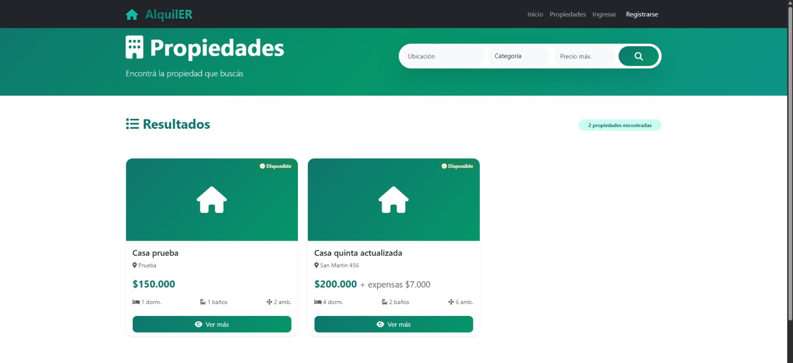

# Documento Técnico — Sistema AlquilER

## 1. Descripción General del Sistema

### Nombre del sistema
**AlquilER** — Sistema de gestión y alquiler de propiedades

### Tecnologías utilizadas
El sistema está desarrollado utilizando una arquitectura de API REST y las siguientes tecnologías principales:

* **PHP** como lenguaje de programación del backend.
* **MySQL** como sistema gestor de base de datos.
* **Eloquent ORM** mediante `illuminate/database` para el acceso y manejo de datos.
* **Composer** para la gestión de dependencias.
* **JWT (JSON Web Token)** mediante `firebase/php-jwt`, encapsulado detrás de `TokenProviderInterface` y `JwtProvider`.
* **PHP dotenv** para la gestión segura de variables de entorno.
* **Swagger/OpenAPI** mediante `swagger-php` para la documentación de la API.
* **Apache/XAMPP** como entorno de desarrollo local.

### Requerimientos de software

Para ejecutar el backend se requiere:

- PHP 8.2 o superior.
- Composer.
- MySQL 8.0 o MariaDB compatible.
- Git para clonar el repositorio.
- Apache (opcional, por ejemplo XAMPP) o el servidor integrado de PHP.

El proyecto utiliza Eloquent ORM como ORM para el acceso a datos, instalado mediante Composer. No requiere la instalación de Laravel.

### Ejecutar el backend desde cero

1. Clonar el repositorio e ingresar a su carpeta:

   ```sh
   git clone https://github.com/marnafer/alquiler-backend.git
   cd alquiler-backend
   ```

2. Instalar las dependencias:

   ```sh
   composer install
   ```

3. Crear `.env` a partir del ejemplo. En Windows PowerShell:

   ```powershell
   Copy-Item .env.example .env
   ```

   Revisar las credenciales de MySQL (`DB_HOST`, `DB_USERNAME`,
   `DB_PASSWORD`) y establecer `DB_DATABASE=sistema_alquiler_db_dev`, que es el
   nombre que crea y selecciona `create_database.sql`. Reemplazar `JWT_KEY`
   por una clave aleatoria larga.

4. Importar `create_database.sql` con una cuenta MySQL que tenga permisos para
   crear y eliminar bases de datos. El script crea `sistema_alquiler_db_dev`,
   crea las tablas e incluye datos de ejemplo; **intencionalmente ejecuta
   `DROP DATABASE IF EXISTS sistema_alquiler_db_dev` antes de crearla**, por
   lo que cada importación vuelve a inicializar esa base y elimina los datos
   que tuviera. No hace falta crear la base manualmente. En XAMPP se puede
   importar el archivo desde phpMyAdmin.

5. Iniciar el servidor:

   - Servidor integrado de PHP, desde la raíz del proyecto:

     ```sh
     php -S 127.0.0.1:8000 -t public
     ```

   - O con XAMPP: iniciar Apache y MySQL, colocar el repositorio dentro de
     `htdocs` y habilitar `mod_rewrite` y el uso de `.htaccess` (`AllowOverride
     All`) para que las rutas de la API se reescriban a `public/index.php`.

6. Comprobar que el servidor responde:

   - Estado de la API: `http://127.0.0.1:8000/api/health`
   - Documentación interactiva OpenAPI: `http://127.0.0.1:8000/docs/`
   - Una consulta que también comprueba la conexión a MySQL:
     `http://127.0.0.1:8000/api/propiedades`
   - Con XAMPP, sustituir el origen por
     `http://localhost/alquiler-backend/public`, por ejemplo:
     `http://localhost/alquiler-backend/public/api/health`.

El dump actual ya contiene las columnas de precalificación de interesados. La
migración `scripts/migrations/20261010_precalificacion_interesados.sql` solo se
debe ejecutar una vez en bases antiguas que todavía no tengan esas columnas;
no se debe aplicar después de importar el dump actual.

El envío de correo en desarrollo utiliza Mailpit en `127.0.0.1:1025` cuando
`MAIL_HOST` está vacío. Para probar registro, recuperación de contraseña u
otras funciones que envían correo, iniciar Mailpit o configurar un servidor
SMTP en `.env`.

La autenticación admite la cookie `HttpOnly` `access_token` y el encabezado
`Authorization: Bearer`. El inicio de sesión también establece la cookie
`refresh_token`, que se usa para renovar la sesión en
`POST /api/autenticador/refresh`. En entornos distintos de `development`, las
cookies se configuran como `Secure` y `SameSite=None`; usar HTTPS. Para un
frontend en otro origen, incluir su URL exacta en `CORS_ALLOWED_ORIGINS` y
enviar las solicitudes del navegador con credenciales (`credentials:
'include'`). Las solicitudes mutables con cookies requieren un `Origin`
permitido.

### Integración y despliegue continuo

El workflow de GitHub Actions ejecuta las pruebas unitarias y PHP Lint. La
configuración y el procedimiento de CD a AlwaysData, incluidas sus condiciones
de activación y rollback, están documentados en [docs/CI_CD.md](docs/CI_CD.md).

### Prueba de carga local

El script `scripts/stress_test.php` ejecuta una prueba escalonada sobre rutas
GET y reporta latencia total (mínima, promedio, p50, p95 y p99), tiempo hasta
el primer byte, solicitudes por segundo, distribución de códigos HTTP,
errores, bytes descargados y encabezados del limitador. Los resultados se
separan por nivel de concurrencia y ruta. No crea ni modifica datos de negocio
y solo admite destinos locales (`localhost`, `127.0.0.1` o `::1`).

La aplicación debe estar levantada y conectada a una base de datos de prueba.
Para medir concurrencia, usar Apache/XAMPP: el servidor integrado `php -S`
atiende una solicitud a la vez por defecto. El middleware limita las lecturas
GET a 120 solicitudes por minuto; las respuestas `429` se registran aparte y
hacen que el nivel figure como inconcluso, porque no permiten conocer la
capacidad real de la aplicación.

```bash
php scripts/stress_test.php --base-url=http://localhost/alquiler-backend/public --requests=30 --concurrency=1,5,10
```

Por defecto prueba `/api/propiedades?per_page=10`, con dos solicitudes de
calentamiento por ruta y nivel. Los objetivos orientativos son p95 <= 500 ms
y errores <= 1%; son configurables y no constituyen un SLA:

```bash
php scripts/stress_test.php --base-url=http://localhost/alquiler-backend/public --requests=50 --concurrency=1,5,10 --warmup=3 --p95-target-ms=400 --error-target-percent=1 --paths=/api/propiedades?per_page=20
```

Cada ejecución guarda un reporte JSON detallado y un resumen CSV en
`storage/stress-tests/`, incluyendo commit, rama, estado de Git, entorno del
cliente y evaluación por nivel/ruta. Para rutas autenticadas, se puede definir
`STRESS_TEST_BEARER_TOKEN` en el entorno; el token no se guarda en los reportes.
`OK` indica que se cumplieron los objetivos configurados; `REVISAR` que se
superó alguno; `INCONCLUSO` que hubo respuestas `429`; `PROVISIONAL` indica
menos de 30 solicitudes en alguna ruta/nivel. El proceso termina con código 1
si hay que revisar, 2 si el limitador impidió concluir y 0 si no se detectó
ninguna de esas condiciones.
La medición no desglosa CPU, memoria ni tiempo exclusivo de base de datos. Para
comparar resultados, mantener iguales los datos, el entorno y los parámetros,
usar al menos 30 solicitudes medidas por ruta y nivel, y repetir cada corrida.

### Instrumentación de rendimiento por entorno

La instrumentación registra un evento JSON por línea en
`storage/logs/<APP_ENV>/performance.jsonl`, separando automáticamente las
métricas de cada entorno (por ejemplo, `storage/logs/development/` y
`storage/logs/production/`). El estado de capturas del dashboard también se
separa por entorno en `storage/performance-dashboard/<APP_ENV>/`. Está
desactivada por defecto y se activa con `PERFORMANCE_METRICS_ENABLED=true`.
El dashboard local permite seleccionar `development` o una copia local de
`production`.

```dotenv
# `.env` local
APP_ENV=development
PERFORMANCE_METRICS_ENABLED=true
PERFORMANCE_METRICS_SLOW_SQL_MS=100
```

El umbral de consultas lentas está expresado en milisegundos; el valor inicial
es 100 ms. La instrumentación registra la duración total de la petición con un
reloj monotónico, el código HTTP y métricas SQL agregadas. Una consulta que
alcanza el umbral se cuenta como lenta. Se conserva como máximo el detalle de
10 consultas lentas por petición; su huella SHA-256 sirve para agrupar consultas
sin guardar el SQL ni sus bindings.

Los eventos incluyen fecha UTC, identificador de petición, método, plantilla de
ruta cuando se conoce, estado HTTP, duración total y cantidad/duración
acumulada de consultas y, si hay una captura activa desde el dashboard, su
identificador de sesión. Sin captura activa, `session_id` queda en `null`.
No se registran tokens, encabezados, cuerpos de
petición, credenciales ni valores de bindings. Las consultas fallidas no
generan `QueryExecuted`, por lo que este contador mide consultas notificadas
por Illuminate tras ejecutarse.

Cada archivo tiene un límite de 5 MiB y conserva hasta tres generaciones rotadas
(`performance.jsonl.1` a `.3`). Si falla el registro, el error se envía al log
de PHP y no debe impedir la respuesta. Los archivos de métricas y de bloqueo
están excluidos de Git; se recomienda limitar el acceso a `storage/logs/` al
usuario local que ejecuta PHP.

En producción configura `APP_ENV=production` y
`PERFORMANCE_METRICS_ENABLED=true` en el entorno del servidor (o en su `.env`
privado). Así se escriben en `storage/logs/production/`, sin compartir el
archivo local. No subas credenciales ni el `.env` de producción al repositorio.
Las métricas antiguas que estuvieran directamente en
`storage/logs/performance.jsonl` no se mueven automáticamente; si quieres
conservarlas en el historial local, muévelas a
`storage/logs/development/performance.jsonl` junto con sus archivos rotados.

#### Importar métricas de producción al dashboard local

1. En el panel HTTPS seguro de tu hosting, descarga el archivo actual
   `storage/logs/production/performance.jsonl` del servidor. No expongas
   `storage/` mediante el servidor web ni crees un endpoint público para este
   archivo.
2. En tu equipo local, guarda o reemplaza la copia en
   `storage/logs/production/performance.jsonl`. No hace falta copiar las
   generaciones rotadas: la vista de producción analiza el archivo actual.
3. Abre el dashboard local y selecciona **Producción importada** en el selector
   de entorno. Para volver a las métricas de tu equipo, selecciona
   **Desarrollo local**.

El dashboard local permanece ligado a `127.0.0.1`; no se conecta a producción.
Los `.gitkeep` mantienen preparadas ambas carpetas, pero los logs, incluidos
los importados, siguen excluidos de Git.

La instrumentación se inicia para rutas bajo `/api/`. Las respuestas `429`
producidas antes del despacho pueden quedar sin plantilla de ruta. En el
flujo actual, `/api/health` se responde antes del rate limiter y no queda
sujeto a ese límite.

Para revisar las líneas del log en PowerShell:

```powershell
Get-Content storage/logs/development/performance.jsonl | ForEach-Object {
    $_ | ConvertFrom-Json
} | Select-Object timestamp_utc, request_id, method, route, status_code, duration_ms,
    @{Name='sql_count';Expression={$_.sql.query_count}},
    @{Name='sql_total_ms';Expression={$_.sql.total_ms}},
    @{Name='slow_sql_count';Expression={$_.sql.slow_query_count}}
```

Las duraciones SQL y HTTP se deben interpretar juntas y contrastar en varias
corridas; una consulta lenta individual no demuestra por sí sola que sea el
cuello de botella.

#### Capturas por sesión y actualización en vivo

En Windows, desde la raíz del backend, ejecuta:

```powershell
.\scripts\abrir_dashboard_performance.ps1
```

El script genera el dashboard, inicia (o reutiliza) un servidor local ligado
solo a `127.0.0.1:8765` y abre `http://127.0.0.1:8765`. También puedes iniciar
el servidor manualmente:

```bash
php -S 127.0.0.1:8765 scripts/performance_dashboard_server.php
```

Mantén `APP_ENV=development` y `PERFORMANCE_METRICS_ENABLED=true` en `.env`.
Desde el dashboard, pulsa **Iniciar captura**, usa la aplicación y pulsa
**Detener captura**. Mientras está activa, los resultados se actualizan cada
3 segundos; el selector permite volver a consultar las sesiones anteriores.
Cada captura tiene un identificador distinto y no requiere borrar ni mover los
logs. El servidor de control solo escucha en loopback y exige validación de
origen y token local para iniciar o detener una sesión. Termina el servidor
en la ventana de consola que abrió el lanzador, o en la terminal manual, con
`Ctrl+C`.

El botón no activa ni modifica `.env`: si la instrumentación no está habilitada,
el dashboard no permite iniciar la captura. Las solicitudes que ya estaban en
curso al detenerla pueden terminar y quedar asociadas a esa sesión. Las sesiones
se guardan en los logs existentes, sujetos a su rotación de 5 MiB y tres
respaldos. Para generar un HTML estático de una sesión concreta:

```bash
php scripts/generar_dashboard_performance.php --session=IDENTIFICADOR_DE_32_CARACTERES
```

### Datos sintéticos para pruebas de carga

`scripts/generar_datos_stress.php` crea usuarios, propiedades, relaciones con
servicios, consultas/mensajes, favoritos y reservas ficticias. La simulación
por defecto estima 10.000 usuarios, 10.000 propiedades, 5.000 consultas,
15.000 favoritos y 2.000 reservas. No crea archivos de imágenes.

El script solo acepta `APP_ENV=development`, una conexión MySQL local y
`DB_DATABASE=sistema_alquiler_db_dev`. Primero revisar el plan sin escribir:

```bash
php scripts/generar_datos_stress.php --dry-run
```

Para insertar hay que solicitarlo explícitamente:

```bash
php scripts/generar_datos_stress.php --execute
```

La carga es aditiva: no elimina ni trunca tablas. Los correos usan el dominio
reservado `.invalid`, las contraseñas se generan aleatoriamente y las
ejecuciones repetidas omiten los registros sintéticos que ya existen. Aun así,
se recomienda una copia de seguridad antes de poblar la base local, porque el
volumen agregado puede afectar otras pruebas y ocupar espacio. Ajustar el
volumen con `--users=N`, `--properties=N`, `--consultations=N`,
`--favorites=N` y `--reservations=N`. Los usuarios sintéticos usan únicamente
el rol estándar; no se crean cuentas administradoras.

### Alcance funcional

Este repositorio contiene el backend REST de AlquilER; los clientes web o
móviles se ejecutan por separado. La API cubre autenticación y recuperación de
cuenta, usuarios, propiedades e imágenes, catálogos geográficos, favoritos,
consultas y sus mensajes, reservas, reseñas, servicios, notificaciones,
contacto y consulta administrativa de logs. El detalle vigente de rutas,
seguridad y esquemas está en el [contrato API](./docs/API-CONTRACT.md) y en la
[especificación OpenAPI](./public/docs/openapi.json).

### Interfaz del sistema
**Captura de pantalla de la interfaz:**

 

---

## 2. Mapa de Componentes

La estructura del backend se organiza mediante diferentes capas y responsabilidades. El objetivo es evitar que una misma clase concentre responsabilidades pertenecientes a distintas capas.

| Archivo / Componente | Responsabilidad |
| :--- | :--- |
| `public/index.php` | Carga de entorno, CORS, cookies/CSRF, rate limit y entrada HTTP |
| `src/Routes/api.php`, `src/Routes/Router.php` | Registro y despacho de rutas |
| `src/bootstrap.php` | Ensamblado de controladores, servicios y dependencias |
| `src/Controllers/Api/` | Adaptación entre solicitudes HTTP y servicios |
| `src/Services/` | Reglas de negocio y coordinación de operaciones |
| `src/Repositories/`, `src/Models/` | Persistencia mediante Eloquent |
| `src/Validators/`, `src/Sanitizers/` | Validación y normalización de datos |
| `src/Security/Authenticator.php` | Validación de JWT y permisos por usuario/rol |
| `src/Http/` | Solicitudes, respuestas HTTP y cookies de autenticación |
| `src/Docs/`, `public/docs/` | Atributos OpenAPI y especificación/documentación servida |
| `src/database.php`, `config/config.php`, `.env` | Configuración de la conexión y del entorno |

### Organización general

El flujo de una solicitud es:

`Cliente` → `public/index.php` → `src/Routes/Router.php` → controlador → servicio → repositorio/modelo → base de datos → respuesta HTTP.

`public/index.php` carga `.env`, prepara la solicitud y aplica las comprobaciones HTTP globales; las rutas se registran en `src/Routes/api.php`. Ese archivo obtiene las instancias creadas en `src/bootstrap.php`. Los controladores delegan las reglas de negocio en servicios; la persistencia se realiza con Eloquent. El detalle de responsabilidades puede variar según el recurso.

La especificación OpenAPI servida en `public/docs/` documenta los esquemas de entrada y salida. El índice de rutas en `docs/API-CONTRACT.md` sirve como referencia rápida; si se modifica una ruta o su comportamiento, se deben mantener sincronizados ambos documentos.

---

## 3. Autenticación y solicitudes

Las rutas protegidas aceptan el JWT mediante la cookie `access_token` o el
encabezado `Authorization: Bearer <token>`. El login establece cookies
`HttpOnly`; el refresh token se usa en las rutas de autenticación. La
autorización adicional (por ejemplo, permisos de administrador o titularidad
del recurso) depende del endpoint.

Las solicitudes con cuerpo JSON deben enviar `Content-Type: application/json`.
La carga de imágenes usa el tipo de contenido indicado por su operación
OpenAPI. Las solicitudes mutables con cookies requieren un origen permitido
por `CORS_ALLOWED_ORIGINS`.

Las respuestas exitosas y los errores se serializan como JSON. Las respuestas
de validación pueden incluir `validation_errors`; los errores inesperados se
registran en el servidor con un identificador de solicitud. Los códigos y
esquemas concretos se describen por operación en OpenAPI.

## Evidencia de pruebas

[GET-PROPIEDADES](./docs/capturas/get-propiedades.png)
[POST-LOGIN](./docs/capturas/post-login.png)
[POST-PROPIEDADES-1](./docs/capturas/post-propiedades-1.png)
[POST-PROPIEDADES-2](./docs/capturas/post-propiedades-2.png)
[PUT-PROPIEDADES](./docs/capturas/put-propiedades-1.png)


## 4. Esquema y datos de desarrollo

- `create_database.sql` crea el esquema y carga registros de ejemplo en
  `sistema_alquiler_db_dev`; al importarlo, esa base se elimina y se vuelve a
  crear.
- Las migraciones incrementales están en `scripts/migrations/`. La migración
  de precalificación es solo para bases anteriores que aún no tienen esas
  columnas.
- `scripts/seed_e2e_users.php` agrega usuarios de prueba E2E; los scripts de
  carga y datos sintéticos están descritos en la sección de pruebas de carga.

## 5. Tests

- `composer test`: suites unitarias y de integración.
- `composer test:unit`: suite unitaria.
- `composer test:integration`: integración con MySQL accesible mediante la
  configuración de `.env`.
- Para generar cobertura HTML se requiere Xdebug:
  `vendor/bin/phpunit --coverage-html coverage/`.
