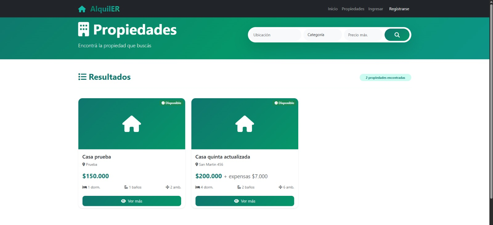

# Documento Técnico — Sistema AlquilER

## 1. Descripción General del Sistema

### Nombre del sistema
**AlquilER** — Sistema de gestión y alquiler de propiedades

### Tecnologías utilizadas
El sistema está desarrollado utilizando una arquitectura de API REST y las siguientes tecnologías principales:

* **PHP** como lenguaje de programación del backend.
* **MySQL** como sistema gestor de base de datos.
* **Eloquent ORM** mediante `illuminate/database` para el acceso y manejo de datos.
* **Composer** para la gestión de dependencias.
* **JWT (JSON Web Token)** mediante `firebase/php-jwt`, encapsulado detrás de `TokenProviderInterface` y `JwtProvider`.
* **PHP dotenv** para la gestión segura de variables de entorno.
* **Swagger/OpenAPI** mediante `swagger-php` para la documentación de la API.
* **Apache/XAMPP** como entorno de desarrollo local.

### Requerimientos de software

Para ejecutar el backend se requiere:

*PHP 8.2 o superior
*Composer
*MySQL 8.0 o superior
*XAMPP o WAMP para disponer de Apache y MySQL
*Git para clonar el repositorio

El proyecto utiliza Eloquent ORM como ORM para el acceso a datos, instalado mediante Composer. No requiere la instalación de Laravel.

### Pasos para ejecutar el backend
* **1. Clonar el repositorio**

Clonar el repositorio utilizando Git:

git clone https://github.com/marnafer/alquiler-backend.git
* **2. Ingresar a la carpeta del proyecto**
* **cd alquiler-backend**
* **3. Instalar las dependencias**

Ejecutar:

composer install
* **4. Crear la base de datos**

*Crear una base de datos MySQL llamada:

*sistema_alquiler_db_dev

*Luego importar el archivo:

*create_database.sql

El archivo contiene la estructura necesaria para crear las tablas de la aplicación.

* **5. Configurar las variables de entorno**

Configurar el archivo .env con los datos correspondientes a la conexión de la base de datos y demás parámetros requeridos por el backend.

* **Ejemplo:**

DB_HOST=localhost
DB_DATABASE=sistema_db_dev
DB_USERNAME=root
DB_PASSWORD=

JWT_KEY=cambiar_por_una_clave_aleatoria_larga
JWT_EXP=3600

APP_ENV=development
APP_DEBUG=true

* **6. Ejecutar el backend**
*Opción A: Servidor integrado de PHP

*Desde la raíz del proyecto:

*php -S localhost:8000 -t public

*Luego acceder desde el navegador a:

*http://localhost:8000

Si la base de datos ya existía antes de incorporar la precalificación de
interesados, ejecutar una vez el script
`scripts/migrations/20261010_precalificacion_interesados.sql` sobre esa base.
* **Opción B: XAMPP**
*Abrir XAMPP.
*Iniciar los servicios Apache y MySQL.
*Colocar el proyecto dentro del directorio htdocs de XAMPP.
*Verificar que la base de datos sistema_alquiler_db_dev haya sido creada e importada correctamente.
*Acceder desde el navegador a:
*http://localhost/alquiler-backend/public

Si Apache está configurado para utilizar otro puerto, utilizar el puerto correspondiente en la URL.

### Prueba de carga local

El script `scripts/stress_test.php` ejecuta una prueba escalonada sobre rutas
GET y reporta latencia total (mínima, promedio, p50, p95 y p99), tiempo hasta
el primer byte, solicitudes por segundo, distribución de códigos HTTP,
errores, bytes descargados y encabezados del limitador. Los resultados se
separan por nivel de concurrencia y ruta. No crea ni modifica datos de negocio
y solo admite destinos locales (`localhost`, `127.0.0.1` o `::1`).

La aplicación debe estar levantada y conectada a una base de datos de prueba.
Para medir concurrencia, usar Apache/XAMPP: el servidor integrado `php -S`
atiende una solicitud a la vez por defecto. El middleware limita las lecturas
GET a 120 solicitudes por minuto; las respuestas `429` se registran aparte y
hacen que el nivel figure como inconcluso, porque no permiten conocer la
capacidad real de la aplicación.

```bash
php scripts/stress_test.php --base-url=http://localhost/alquiler-backend/public --requests=30 --concurrency=1,5,10
```

Por defecto prueba `/api/propiedades?per_page=10`, con dos solicitudes de
calentamiento por ruta y nivel. Los objetivos orientativos son p95 <= 500 ms
y errores <= 1%; son configurables y no constituyen un SLA:

```bash
php scripts/stress_test.php --base-url=http://localhost/alquiler-backend/public --requests=50 --concurrency=1,5,10 --warmup=3 --p95-target-ms=400 --error-target-percent=1 --paths=/api/propiedades?per_page=20
```

Cada ejecución guarda un reporte JSON detallado y un resumen CSV en
`storage/stress-tests/`, incluyendo commit, rama, estado de Git, entorno del
cliente y evaluación por nivel/ruta. Para rutas autenticadas, se puede definir
`STRESS_TEST_BEARER_TOKEN` en el entorno; el token no se guarda en los reportes.
`OK` indica que se cumplieron los objetivos configurados; `REVISAR` que se
superó alguno; `INCONCLUSO` que hubo respuestas `429`; `PROVISIONAL` indica
menos de 30 solicitudes en alguna ruta/nivel. El proceso termina con código 1
si hay que revisar, 2 si el limitador impidió concluir y 0 si no se detectó
ninguna de esas condiciones.
La medición no desglosa CPU, memoria ni tiempo exclusivo de base de datos. Para
comparar resultados, mantener iguales los datos, el entorno y los parámetros,
usar al menos 30 solicitudes medidas por ruta y nivel, y repetir cada corrida.

### Instrumentación local de rendimiento

La instrumentación registra un evento JSON por línea en
`storage/logs/performance.jsonl`. Está desactivada por defecto. Solo se activa
cuando `.env` tiene `APP_ENV=development` y
`PERFORMANCE_METRICS_ENABLED=true`.

```dotenv
APP_ENV=development
PERFORMANCE_METRICS_ENABLED=true
PERFORMANCE_METRICS_SLOW_SQL_MS=100
```

El umbral de consultas lentas está expresado en milisegundos; el valor inicial
es 100 ms. La instrumentación registra la duración total de la petición con un
reloj monotónico, el código HTTP y métricas SQL agregadas. Una consulta que
alcanza el umbral se cuenta como lenta. Se conserva como máximo el detalle de
10 consultas lentas por petición; su huella SHA-256 sirve para agrupar consultas
sin guardar el SQL ni sus bindings.

Los eventos incluyen fecha UTC, identificador de petición, método, plantilla de
ruta cuando se conoce, estado HTTP, duración total y cantidad/duración
acumulada de consultas. No se registran tokens, encabezados, cuerpos de
petición, credenciales ni valores de bindings. Las consultas fallidas no
generan `QueryExecuted`, por lo que este contador mide consultas notificadas
por Illuminate tras ejecutarse.

El archivo tiene un límite de 5 MiB y conserva hasta tres generaciones rotadas
(`performance.jsonl.1` a `.3`). Si falla el registro, el error se envía al log
de PHP y no debe impedir la respuesta. Los archivos de métricas y de bloqueo
están excluidos de Git; se recomienda limitar el acceso a `storage/logs/` al
usuario local que ejecuta PHP.

La instrumentación se inicia para rutas bajo `/api/`. Las respuestas `429`
producidas antes del despacho pueden quedar sin plantilla de ruta. En el
flujo actual, `/api/health` se responde antes del rate limiter y no queda
sujeto a ese límite.

Para revisar las líneas del log en PowerShell:

```powershell
Get-Content storage/logs/performance.jsonl | ForEach-Object {
    $_ | ConvertFrom-Json
} | Select-Object timestamp_utc, request_id, method, route, status_code, duration_ms,
    @{Name='sql_count';Expression={$_.sql.query_count}},
    @{Name='sql_total_ms';Expression={$_.sql.total_ms}},
    @{Name='slow_sql_count';Expression={$_.sql.slow_query_count}}
```

Las duraciones SQL y HTTP se deben interpretar juntas y contrastar en varias
corridas; una consulta lenta individual no demuestra por sí sola que sea el
cuello de botella.

### Datos sintéticos para pruebas de carga

`scripts/generar_datos_stress.php` crea usuarios, propiedades, relaciones con
servicios, consultas/mensajes, favoritos y reservas ficticias. La simulación
por defecto estima 10.000 usuarios, 10.000 propiedades, 5.000 consultas,
15.000 favoritos y 2.000 reservas. No crea archivos de imágenes.

El script solo acepta `APP_ENV=development`, una conexión MySQL local y
`DB_DATABASE=sistema_alquiler_db_dev`. Primero revisar el plan sin escribir:

```bash
php scripts/generar_datos_stress.php --dry-run
```

Para insertar hay que solicitarlo explícitamente:

```bash
php scripts/generar_datos_stress.php --execute
```

La carga es aditiva: no elimina ni trunca tablas. Los correos usan el dominio
reservado `.invalid`, las contraseñas se generan aleatoriamente y las
ejecuciones repetidas omiten los registros sintéticos que ya existen. Aun así,
se recomienda una copia de seguridad antes de poblar la base local, porque el
volumen agregado puede afectar otras pruebas y ocupar espacio. Ajustar el
volumen con `--users=N`, `--properties=N`, `--consultations=N`,
`--favorites=N` y `--reservations=N`. Los usuarios sintéticos usan únicamente
el rol estándar; no se crean cuentas administradoras.

### Propósito general
El sistema AlquilER tiene como objetivo gestionar el alquiler de propiedades, permitiendo centralizar la información relacionada con propiedades, usuarios, reservas, consultas, servicios y demás elementos asociados al proceso de alquiler. 

El backend se desarrolla como una API REST, permitiendo que posteriormente pueda ser consumido por diferentes clientes, como una aplicación web y una aplicación móvil, manteniendo separada la lógica del servidor de las interfaces de usuario.

### Módulos principales
La API se encuentra organizada alrededor de las siguientes entidades principales:

* **Autenticador:** registro, inicio y cierre de sesión mediante JWT.
* **Usuarios:** gestión de los usuarios del sistema y sus roles.
* **Propiedades:** administración y consulta de las propiedades disponibles.
* **Imágenes:** gestión de las imágenes asociadas a las propiedades.
* **Categorías:** clasificación de las propiedades.
* **Provincias y localidades:** organización geográfica de las propiedades.
* **Roles:** definición de los permisos y tipos de usuario.
* **Favoritos:** permite a los usuarios guardar propiedades de interés.
* **Consultas:** gestión de consultas realizadas sobre propiedades.
* **Reservas:** administración del proceso de reserva de propiedades.
* **Reseñas:** valoración y comentarios sobre propiedades.
* **Servicios:** servicios disponibles para las propiedades.
* **Propiedad-Servicios:** relación entre propiedades y servicios.
* **Log de actividad:** registro de determinadas acciones realizadas en el sistema.

> La API utiliza respuestas JSON estandarizadas y maneja códigos HTTP según el resultado de cada operación.

### Interfaz del sistema
**Captura de pantalla de la interfaz:**

 

---

## 2. Mapa de Componentes

La estructura del backend se organiza mediante diferentes capas y responsabilidades. El objetivo es evitar que una misma clase concentre responsabilidades pertenecientes a distintas capas.

| Archivo / Componente | Capa identificada |
| :--- | :--- |
| `public/index.php` | Entrada / API |
| `src/routes/api.php` | Routing |
| `src/routes/Router.php` | Routing |
| `src/controllers/Api/` | BLL / Controladores |
| `src/Models/` | DAL / Acceso y representación de datos |
| `src/validators/` | BLL / Validación |
| `src/sanitizers/` | BLL / Sanitización |
| `src/middlewares/` | Autenticación / Autorización |
| `src/helpers/Response.php` | API / Respuestas HTTP |
| `src/helpers/TokenProviderInterface.php` | Contrato de autenticación |
| `src/helpers/JwtProvider.php` | Implementación JWT |
| `src/helpers/JwtHelper.php` | Soporte técnico JWT |
| `src/repositories/UsuarioRepositoryInterface.php` | Contrato de persistencia |
| `src/repositories/EloquentUsuarioRepository.php` | Implementación del repositorio |
| `src/repositories/LogActividadRepositoryInterface.php` | Contrato de consulta y persistencia de logs |
| `src/repositories/EloquentLogActividadRepository.php` | Implementación del repositorio de logs |
| `src/services/LogActividadService.php` | Lógica de consulta y registro de actividad |
| `src/services/` | Lógica de negocio |
| `src/database.php` | DAL / Configuración de acceso a datos |
| `config/config.php` | Configuración |
| `.env` | Configuración de entorno |
| `src/debug/` | Soporte / Desarrollo |

### Organización general

El flujo principal de una petición puede representarse de la siguiente manera:

`Cliente` → `public/index.php` → `Router` → `Middleware` → `Controller` → `Service` → `Repository / Provider` → `Model / BD` → `Response`

Los controladores coordinan la petición y delegan la lógica de negocio en los servicios. Los servicios utilizan repositorios para acceder a los datos y proveedores para resolver operaciones técnicas, como la generación y validación de tokens.

Las implementaciones concretas se conectan actualmente en `src/routes/api.php`. Está previsto extraer este wiring a un archivo de bootstrap o contenedor independiente.

---

## 3. Problemas de Diseño Detectados

Durante el análisis inicial del sistema se detectaron diferentes situaciones en las que existía una mezcla de responsabilidades. Estos problemas constituyen puntos de partida para las refactorizaciones posteriores.

### 3.1. Controladores con exceso de responsabilidades
* **Archivo:** `src/controllers/Api/`
* **Problema:** Algunos controladores concentran diferentes tareas dentro de una misma clase, como recepción de datos, validación, sanitización, aplicación de reglas de negocio, acceso a modelos y construcción de respuestas HTTP. Esto dificulta el mantenimiento y hace que los controladores dependan de demasiados componentes.
* **Propuesta preliminar:** Separar progresivamente las responsabilidades, dejando en los controladores principalmente la coordinación de la petición y delegando la validación, sanitización y lógica específica a sus respectivos componentes.

### 3.2. Acceso a datos y lógica de negocio demasiado acoplados
* **Archivos:** `src/controllers/Api/` y `src/Models/`
* **Problema:** Parte de la lógica necesaria para realizar determinadas operaciones puede quedar directamente relacionada con la forma en que se consulta o modifica la base de datos. Esto genera un acoplamiento entre la lógica de negocio y la persistencia.
* **Propuesta preliminar:** Centralizar progresivamente las operaciones relacionadas con la persistencia y las relaciones entre entidades, evitando que los controladores tengan que conocer detalles innecesarios de la base de datos. De esta forma se busca una separación más clara entre BLL y DAL.

### 3.3. Responsabilidades relacionadas con autenticación distribuidas
* **Archivos:** `src/middlewares/`, `src/helpers/JwtHelper.php` y controladores relacionados con autenticación.
* **Problema:** La autenticación requiere diferentes tareas: generación y validación de tokens, extracción del token de la petición, comprobación de permisos y aplicación de restricciones según el rol. Si estas responsabilidades se mezclan con la lógica propia de los controladores, aumenta el acoplamiento y se dificulta reutilizar los mecanismos de seguridad.
* **Solución implementada:** La generación y validación de tokens se abstrae mediante `TokenProviderInterface`. `JwtProvider` implementa este contrato y delega actualmente en `JwtHelper`. El middleware utiliza el proveedor configurado desde el wiring centralizado para validar los tokens y controlar el acceso según la autenticación y el rol del usuario.

### 3.4. Construcción de respuestas HTTP dentro de la lógica de las operaciones
* **Archivo:** `src/helpers/Response.php` y controladores.
* **Problema:** La API necesita mantener una estructura uniforme para las respuestas exitosas y los errores. Si cada controlador construye manualmente las respuestas, pueden aparecer diferencias en nombres de campos, códigos HTTP y estructuras JSON.
* **Propuesta preliminar:** Centralizar la construcción de respuestas HTTP mediante el helper `Response`, manteniendo una estructura uniforme para respuestas exitosas, errores de validación, autenticación, autorización, recursos inexistentes y conflictos.

### 3.5. Dependencias acopladas a implementaciones concretas

* **Archivos:** `src/services/`, `src/controllers/Api/` y `src/routes/api.php`.
* **Problema:** Los servicios y controladores pueden quedar acoplados a implementaciones concretas, como `UsuarioRepository` o `JwtHelper`. Esto dificulta reemplazar componentes y realizar pruebas unitarias aisladas.
* **Solución implementada:** Los servicios dependen de interfaces (`UsuarioRepositoryInterface` y `TokenProviderInterface`) en lugar de clases concretas. `EloquentUsuarioRepository` implementa la interfaz de persistencia y `JwtProvider` implementa la interfaz de tokens.
* **Wiring actual:** Las implementaciones concretas se construyen y conectan en `src/routes/api.php`, que actualmente centraliza la creación de repositorios, proveedores, servicios y controladores.
* **Evolución prevista:** En una etapa posterior, este ensamblado se extraerá a un archivo de bootstrap o contenedor independiente, dejando `api.php` enfocado principalmente en el registro de rutas.

El flujo de dependencias queda organizado de la siguiente manera:

`AutenticadorController` → `AutenticadorService` → `UsuarioRepositoryInterface` / `TokenProviderInterface` / `LogActividadService`

`UsuarioController` → `UsuarioService` → `UsuarioRepositoryInterface` / `LogActividadService`

`PropiedadService` → `PropiedadRepositoryInterface` / `LogActividadService`

`PropiedadImagenService` → `PropiedadImagenRepositoryInterface` / `LogActividadService`

`UsuarioRepositoryInterface` → `EloquentUsuarioRepository`

`LogActividadRepositoryInterface` → `EloquentLogActividadRepository`

`TokenProviderInterface` → `JwtProvider` → `JwtHelper`

### 3.6. Registro centralizado de actividad

El registro de actividad se concentra en `LogActividadService`. Los servicios de negocio informan las acciones auditables y este servicio se encarga de sanitizar, validar, completar la dirección IP y la fecha, y persistir el registro mediante `LogActividadRepositoryInterface`.

Los logs se exponen únicamente mediante endpoints de consulta para administradores. No existe un CRUD público para crear, modificar o eliminar registros de actividad.

---

## 4. Plan Preliminar de Mejora

El proceso de mejora priorizará inicialmente la consolidación de la arquitectura y la separación de responsabilidades:

1. **Integrantes:** Fernandez Mariano, Pretz Julian.
2. **Roles asignados:** Fernandez Mariano: Teach lead, dev backend. Pretz Julian: deb frontend, QA / Documentador.
3. **Dominio:** Gestión inmobiliaria y alquiler de propiedades. Entidades principales: Propiedad, Usuario, Reserva, Categoria y Servicio.

---

## 5. Plan Preliminar de Mejora

El proceso de mejora priorizará inicialmente la consolidación de la arquitectura y la separación de responsabilidades:

1. **Revisión de base de datos:** En primer lugar se verificará la estructura de la base de datos, sus relaciones y restricciones de integridad.
2. **Revisión de flujo:** Posteriormente se revisará el flujo general de la API y la separación entre routing, autenticación, controladores, validación y acceso a datos.
3. **Refactorización:** Luego se refactorizarán los componentes que presenten mayor acoplamiento o mezcla de responsabilidades.
4. **Estandarización:** Finalmente se revisará el manejo uniforme de respuestas, errores, seguridad y consultas a la base de datos. 

El objetivo es obtener una API REST más mantenible, segura, escalable y preparada para ser consumida por diferentes clientes.

## Evidencia de pruebas

[GET-PROPIEDADES](./docs/capturas/get-propiedades.png)
[POST-LOGIN](./docs/capturas/post-login.png)
[POST-PROPIEDADES-1](./docs/capturas/post-propiedades-1.png)
[POST-PROPIEDADES-2](./docs/capturas/post-propiedades-2.png)
[PUT-PROPIEDADES](./docs/capturas/put-propiedades-1.png)
